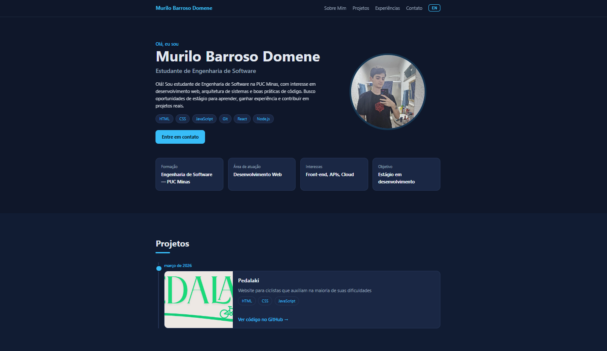
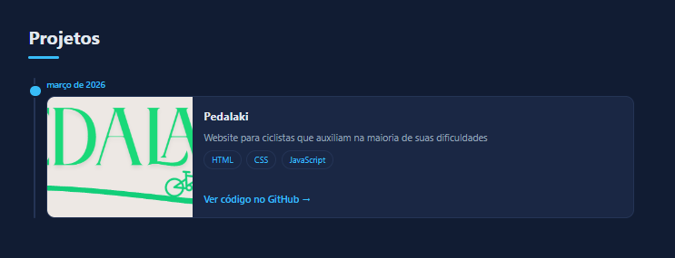
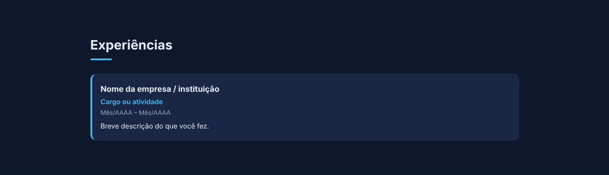
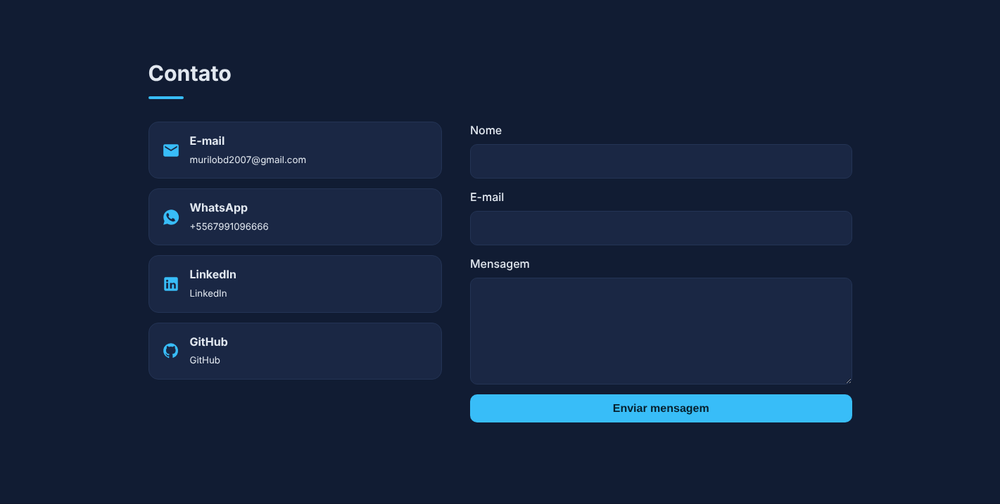
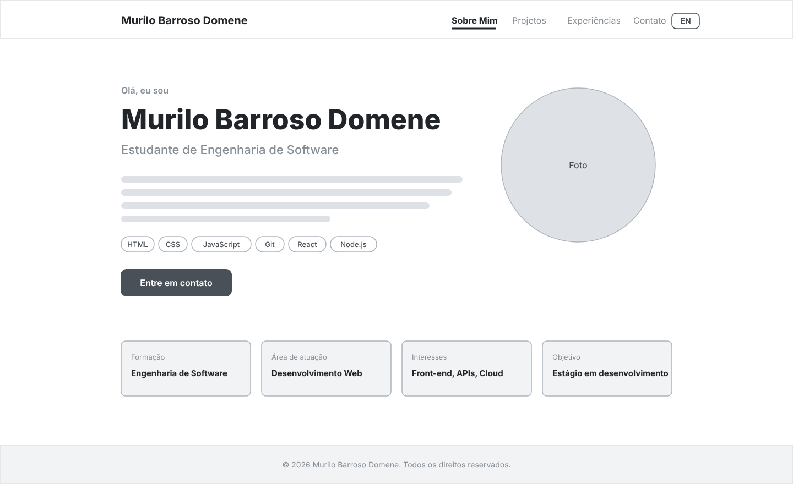
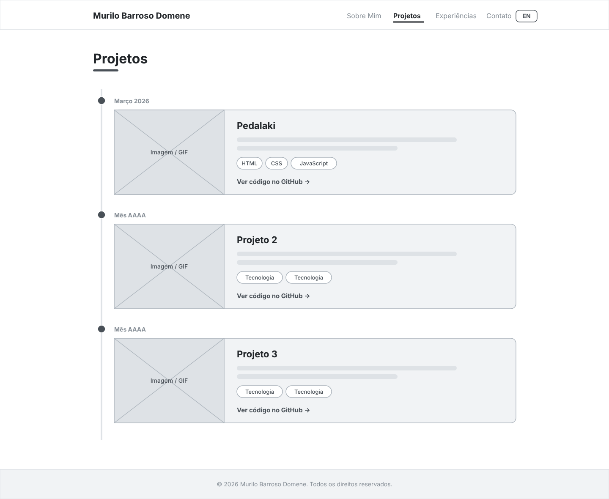
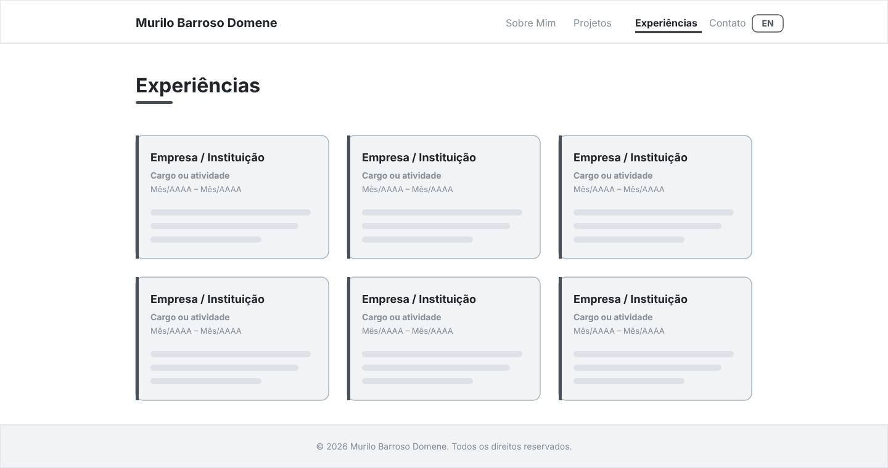
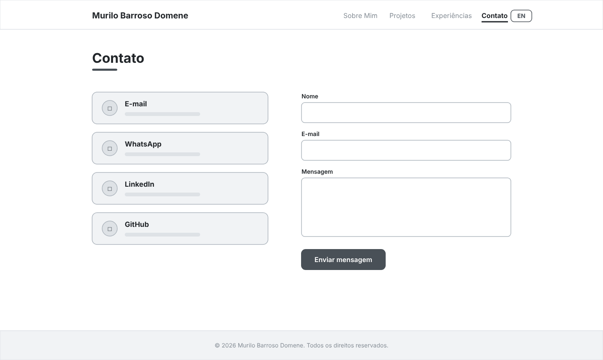

# 💼 Portfólio Profissional 👨‍💻

> [!NOTE]
> Website de portfólio profissional, responsivo e bilíngue (PT/EN), para apresentar minha trajetória, projetos, experiências e formas de contato.

---

## 🚧 Status do Projeto


---

## 📚 Índice
- [Links Úteis](#-links-úteis)
- [Sobre o Projeto](#-sobre-o-projeto)
- [Funcionalidades Principais](#-funcionalidades-principais)
- [Tecnologias Utilizadas](#-tecnologias-utilizadas)
- [Arquitetura](#-arquitetura)
- [Instalação e Execução](#-instalação-e-execução)
- [Como Editar o Conteúdo](#-como-editar-o-conteúdo)
- [Deploy](#-deploy)
- [Estrutura de Pastas](#-estrutura-de-pastas)
- [Demonstração](#-demonstração)
- [Protótipos (Figma)](#-protótipos-figma)
- [Autor](#-autor)
- [Licença](#-licença)

---

## 🔗 Links Úteis
* 🌐 **Site publicado:** [https://SEU-NOME.vercel.app](https://SEU-NOME.vercel.app) <!-- TODO: trocar pelo link real -->
* 🎨 **Protótipo no Figma:** [Ver wireframes](https://www.figma.com/) <!-- TODO: link do Figma -->

---

## 📝 Sobre o Projeto
Este projeto foi desenvolvido para o **Laboratório 01 – Portfólio Profissional** da disciplina de *Desenvolvimento e Integração de Aplicações Web* (Engenharia de Software – PUC Minas).

O objetivo é reunir em um só lugar minha trajetória, habilidades, projetos e contatos, de forma moderna e acessível. O site possui menu de navegação com quatro seções: **Sobre Mim**, **Projetos**, **Experiências** e **Contato**.

---

## ✨ Funcionalidades Principais
- 🌎 **Sobre Mim bilíngue:** apresentação em português e inglês, com botão para alternar o idioma (a escolha fica salva no navegador).
- 🕒 **Linha do tempo de projetos:** ordenada automaticamente do mais antigo ao mais recente, com descrição, tecnologias, link do GitHub e imagem/GIF.
- 🧑‍💼 **Experiências:** empresa/instituição, cargo, período e descrição.
- 📨 **Contato:** ícones clicáveis (e-mail, WhatsApp, LinkedIn, GitHub) e formulário com validação e envio por e-mail.
- 📱 **Design responsivo** com menu mobile.
- ✏️ **Conteúdo 100% editável** em um único arquivo (`data.js`).

---

## 🛠 Tecnologias Utilizadas

### 💻 Front-end
* **Linguagens:** HTML5, CSS3, JavaScript (ES6+) — sem frameworks e sem etapa de build
* **Estilização:** CSS puro (variáveis CSS, Grid e Flexbox)
* **Ícones:** SVG inline

### 🔌 Integrações
* **Envio de e-mail:** [FormSubmit.co](https://formsubmit.co/) (requisição `fetch` direto do front-end)

### ⚙️ Infraestrutura
* **Hospedagem:** [Vercel](https://vercel.com/)
* **Versionamento:** Git e GitHub
* **Prototipação:** Figma

### 📦 Dependências
Nenhuma. O projeto não usa `npm`, bibliotecas ou frameworks externos.

---

## 🏗 Arquitetura
Site estático de página única (*single page*), dividido em três responsabilidades:

| Arquivo | Responsabilidade |
| :--- | :--- |
| `data.js` | **Dados** do portfólio (textos PT/EN, projetos, experiências, contatos). |
| `app.js` | **Lógica**: renderiza as seções a partir de `data.js`, alterna idioma, valida e envia o formulário. |
| `index.html` + `style.css` | **Estrutura e visual** (cabeçalho, conteúdo, rodapé, responsividade). |

**Decisão arquitetural:** separar dados de apresentação permite atualizar o portfólio (novos projetos, experiências) sem mexer em HTML/CSS.

---

## 🔧 Instalação e Execução

### Pré-requisitos
* Um navegador moderno
* (Opcional) Node.js ou Python para servir os arquivos localmente

### Executando localmente
```bash
git clone https://github.com/Murilo281107/Portfolio.git
cd Portfolio
```

Opção 1 — abrir o arquivo `index.html` diretamente no navegador.

Opção 2 — servidor local:
```bash
# Python
python3 -m http.server 5500
# ou Node.js
npx serve .
```
Acesse **http://localhost:5500** (ou a porta exibida no terminal).

---

## ✏️ Como Editar o Conteúdo
Abra o arquivo **`data.js`** e altere:

* `name`, `role`, `about`, `facts`, `skills` → seção *Sobre Mim*
* `projects` → um bloco por projeto (campo `date` no formato `AAAA-MM`; a ordem na lista não importa)
* `experiences` → um bloco por experiência
* `contact` → e-mail, WhatsApp (somente números com DDI+DDD), LinkedIn, GitHub e `formReceiver`

**Imagens/GIFs:** coloque o arquivo na pasta do projeto (ex.: `assets/projeto1.gif`) e informe o caminho no campo `image`. Para a foto de perfil, use o campo `photo`.

**Formulário de contato:** no primeiro envio, o FormSubmit manda um e-mail de ativação para o endereço de `formReceiver`; clique em confirmar para começar a receber as mensagens.

---

## 🚀 Deploy
O site é publicado na **Vercel**, sem etapa de build:

1. Envie o projeto para um repositório no GitHub.
2. Em [vercel.com](https://vercel.com/), clique em **Add New → Project** e importe o repositório.
3. Em *Framework Preset* escolha **Other** (deixe *Build Command* e *Output Directory* vazios).
4. Clique em **Deploy**. A cada `git push` na branch `main`, o site é atualizado automaticamente.

> 💡 Domínio próprio (`.me` ou `.dev`) gratuito por 1 ano pelo [GitHub Student Developer Pack](https://education.github.com/pack): em *Project → Settings → Domains* da Vercel, adicione o domínio e siga as instruções de DNS.

---

## 📂 Estrutura de Pastas

```
.
├── index.html    # 📄 Estrutura da página (menu, seções, rodapé)
├── style.css     # 🎨 Estilos e responsividade
├── app.js        # ⚙️ Lógica (render, idioma, formulário)
├── data.js       # ✏️ Conteúdo editável do portfólio
├── README.md     # 📘 Documentação
└── assets/       # 🖼️ Imagens do projeto
    ├── minhafoto.png        # foto de perfil
    ├── Pedalaki.png         # imagem do projeto Pedalaki
    ├── print-*.png          # prints do site (sobre, projetos, experiências, contato)
    └── wf-*.png             # wireframes do Figma
```

---

## 🎥 Demonstração

| Início / Sobre Mim | Projetos (timeline) |
| :---: | :---: |
|  |  |
| **Experiências** | **Contato** |
|  |  |

---

## 🎨 Protótipos (Figma)

Wireframes de média fidelidade das quatro páginas, criados no Figma.

| Home | Projetos | Experiências | Contato |
| :---: | :---: | :---: | :---: |
|  |  |  |  |

---

## 👥 Autor

| 👤 Nome | GitHub | LinkedIn | E-mail |
|---------|--------|----------|--------|
| Murilo Barroso Domene | [github.com/Murilo281107](https://github.com/Murilo281107) | [linkedin.com/in/murilo-domene-7522563b2](https://www.linkedin.com/in/murilo-domene-7522563b2/) | murilobd2007@gmail.com |

---

## 📄 Licença
Este projeto é distribuído sob a **Licença MIT**.
